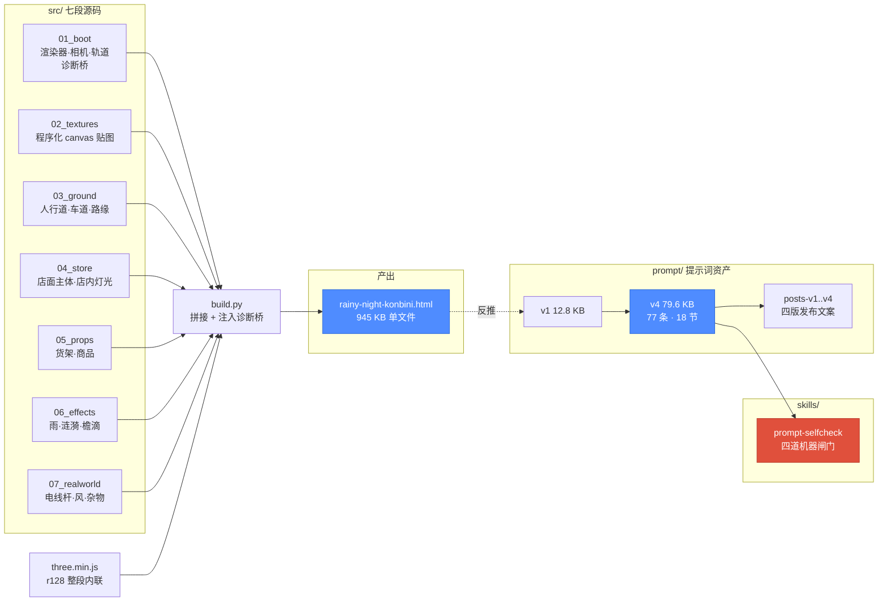
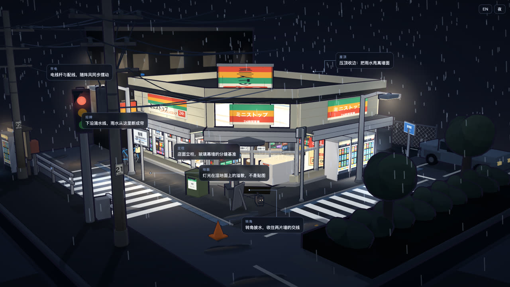
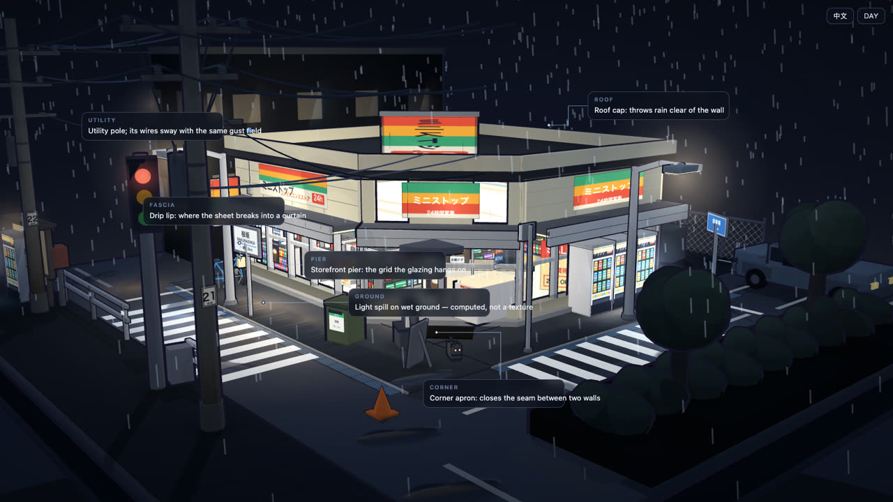

# 雨夜便利店街角 · 微缩 3D 街景

> **一个 945 KB 的单文件 HTML：断网可开、零 UI、三渲二硬边，一座可以自由旋转缩放的雨夜便利店街角微缩模型。**
>
> 附带这份场景**反推出来的 77 条分级提示词**（v1→v4 全文，含修订痕迹），以及从过程中沉淀出的 [`prompt-selfcheck`](skills/prompt-selfcheck/) skill。

<p align="center">
  <a href="https://78tyih.github.io/rainy-night-konbini/showcase.html">
    
  </a><br>
  <sub><b>▶ 68 秒巡览片</b> · 1280×650 · 24fps —— 点封面打开<a href="https://78tyih.github.io/rainy-night-konbini/showcase.html"><b>展示页</b></a>播放，
  或直接下载 <a href="docs/media/konbini-tour.mp4"><code>konbini-tour.mp4</code></a>（14.5 MiB）</sub><br>
  <sub>录自浏览器里<b>实时运行</b>的场景本体，四章：定场 / 推近 / 交互证明 / 回拉。不是合成画面、不是截图。</sub>
</p>

> **为什么这里没有内嵌播放器？** GitHub 的 markdown 会剥掉 `<video>` 标签（相对路径和绝对 URL 一样，
> 实测渲染成空段落）。README 里能「动」的上限是动图，视频只能以可点击的封面 + 链接呈现。
> 想内嵌播放请走<a href="https://78tyih.github.io/rainy-night-konbini/showcase.html">展示页</a>。

| | |
|---|---|
| **类型** | 3D 场景 / 生成式提示词资产 |
| **状态** | 已完成，经 19 轮外部评审（r2–r20） |
| **入口** | [`dist/rainy-night-konbini.html`](dist/rainy-night-konbini.html) —— 下载后双击即开 |
| **在线** | <https://78tyih.github.io/rainy-night-konbini/showcase.html> |
| **巡览视频** | [68 秒 · 实拍浏览器实时渲染](docs/media/konbini-tour.mp4)（[展示页内嵌播放](https://78tyih.github.io/rainy-night-konbini/showcase.html)） |
| **迭代过程报告** | [docs/iteration.html](docs/iteration.html)（[在线](https://78tyih.github.io/rainy-night-konbini/iteration.html)）—— 两条被评审抓出的真错误、19 轮评审时间线、消融实测证据 |
| **展示页** | [`docs/showcase.html`](docs/showcase.html)（ZH/EN × 日/夜） |
| **授权** | **仓库无 LICENSE 文件。方法论可参考，代码复制需授权。** |

---

## 先看一眼

**动态预览**（从巡览片抽的 4 秒循环，README 内唯一会动的元素）：

<p align="center"></p>

**六张静帧**（实时渲染实截，非截图拼贴；机位即源码 `06_effects.js` 里 `ctrl` 的 az / el / dist / target）：

<table>
<tr>
<td width="33%" valign="top"><br><sub><b>① 标准机位</b><br>az 0.86 · el 0.22 · dist 27</sub></td>
<td width="33%" valign="top"><br><sub><b>② 立面近景</b><br>az 0.86 · el 0.20 · dist 13</sub></td>
<td width="33%" valign="top"><br><sub><b>③ 店内透过玻璃</b><br>az 0.86 · el 0.16 · dist 17</sub></td>
</tr>
<tr>
<td width="33%" valign="top"><br><sub><b>④ 地面雨景</b><br>az 1.2 · el 0.05 · dist 9</sub></td>
<td width="33%" valign="top"><br><sub><b>⑤ 街角回望</b><br>az 2.2 · el 0.25 · dist 30</sub></td>
<td width="33%" valign="top"><br><sub><b>⑥ 弱光氛围</b><br>az −0.5 · el 0.35 · dist 38</sub></td>
</tr>
</table>

> **采集条件变了**：这六张是旧流水线（注入 `FREEZE` + 手写机位）出的，同机位两次实截 PSNR ≈ 31 dB ——
> 差的不是机位，是 `Math.random` 播种的门相位 / 蒸汽 / 涟漪，以及「冻结前到底跑了多少帧」。
> 现在机位住进了源码（`src/00_shot.js` 的 `SHOTS` 表），采集走 URL 协议，**同 URL 三次独立进程出图逐字节相同**。
> 完整采集说明与 14 张过程图（含消融 ON/OFF 对）见[**迭代过程报告**](docs/iteration.html)；
> 协议与实测见下一节。

---

## 1 · 解决什么问题

难的不是「搭一个 3D 场景」，而是两件都没有现成答案的事：

**① 让一座微缩模型看着像微缩模型，而不是实景。**
同一个模型，广角一拍就是实景，视角一收才是缩微。差别不在模型，在**相机、色阶、和"什么东西最亮"**。

**② 把只能靠眼睛调的参数，写成别人能照抄的提示词。**
「灯要亮一点」「货架要密一点」这种判断无法移交。本项目把它拆成 77 条，每条标了是**设计判断**（Invariant）还是**项目取值**（Recipe / Implementation）——读者知道哪些必须照抄、哪些该重新推导。

**边界**：本项目不解决建模、不解决 PBR 真实感、不做交互 UI。它是一条「用提示词固化美学方向」的路径。

---

## 2 · 什么场景 → 什么结果

| 场景 | 之前 | 之后 |
|---|---|---|
| 零成本验证一条街景的美学方向 | 开建模软件、找贴图、等编译，改一盏灯要十分钟 | 改提示词一行，刷新浏览器，两秒看到结果 |
| 把「只能意会」的微缩感固化成可移交规格 | 调完即忘，下次从头试错 | 77 条分级条款 + 源码出处表，别人能照抄 |
| 离线演示 / 嵌入任意页面 | 需要构建工具、CDN、贴图文件 | 单个 `.html`，不请求任何外部资源 |

**最小使用路径**：下载 `dist/rainy-night-konbini.html` → 双击打开 → 左键拖拽旋转、滚轮缩放、右键平移。

---

## 3 · 什么结构



### 模块表

| 位置 | 职责 | 边界 |
|---|---|---|
| `src/00_shot.js` | **确定性截图层**：具名机位 `SHOTS`、种子化 PRNG、虚拟时钟、钉死 DPR | 必须排在所有场景块之前；不带 `?capture=1` 时是纯空操作 |
| `src/01_boot.js` | 渲染器 / 相机 / 轨道控制 / 诊断桥 | 不建场景内容 |
| `src/02_textures.js` | 程序化 canvas 贴图（货架排面、地面、品牌色带） | 不读外部图片 |
| `src/03_ground.js` | 人行道 / 车道 / 路缘 / 土壤 | 不含建筑 |
| `src/04_store.js` | 店面主体：立面、腰壁、雨棚、招牌、店内灯光 | 最大的一段 |
| `src/05_props.js` | 货架、商品、室内道具 | 不含建筑与天气 |
| `src/06_effects.js` | 雨、涟漪、檐滴、水洼 | 不含静物 |
| `src/07_realworld.js` | 街外世界：电线杆、围墙、杂物、风 | 不含店面内部 |
| `src/build.py` | 拼接 `three.min.js` + 八段 → 单文件，注入诊断桥 | 唯一构建入口 |
| `src/_rig.py` | 探针夹具：取得 `scene` / `camera` / `renderer` | 仅测试用 |
| `tools/shot.js` | 确定性截图驱动（CDP，零依赖） | 只传 `?shot=`，不存机位 |
| `tools/gate.py` | 构建侧闸门：连构建两次比 md5、块顺序、语法 | 不启动浏览器 |
| `tools/gate.js` | 渲染侧闸门：默认路径未污染 + 两进程逐字节相同 | 需要 Chrome |
| `templates/realtime-caption/` | 图内双语标注子模板 | 不进主产物 |
| `prompt/` | v1–v4 提示词全文 + 四版发布文案 | v1–v3 保留当时错误，未回溯 |
| `skills/prompt-selfcheck/` | 沉淀出的提示词自检 skill | 零第三方依赖 |

---

## 4 · 确定性截图协议（v1）

**为什么要有这一节。** 以前截图靠注入内部变量：`window.FREEZE.on = true; ctrl.az = 0.86; …`。
它看起来是确定的，实测同机位两次实截 **PSNR ≈ 31 dB**。差的不是机位，是四件没人管的事：

| 漏洞 | 后果 |
|---|---|
| `Math.random` 在**构建期**就被消费（门相位、雨的初始相位） | 首帧不可复现——冻结只能冻住运行时 |
| 墙钟推进（06 走 `Clock`，07 走 rAF 时间戳，两个钟） | 「冻结前跑了多少帧」每次都不一样 |
| 相机靠阻尼收敛（`az += (azT-az) * dt*8`） | 落点取决于跑了多少帧，掉一帧就差一点 |
| DPR / 画布尺寸随机器走 | 雨的 `uRes` 变了，像素栅格就变了 |

现在这四件全部钉死，并且**不带任何参数时行为与改动前一模一样**。

### 参数表

| 参数 | 默认 | 说明 |
|---|---|---|
| `capture` | 无 | 必须是 `1` 才进入确定模式。**不带它就完全不生效** |
| `v` | `1` | 协议版本；填别的直接报错退出，不静默降级 |
| `shot` | 无 | 命名机位，见下表 |
| `az` `el` `d` | 由 `shot` 给 | **弧度 / 米**，散装覆盖（注意距离是 `d`，不是 `dist`） |
| `tx` `ty` `tz` | 由 `shot` 给 | 相机目标点 |
| `t` | `8` | 虚拟时钟推进到几秒后冻结 |
| `warm` | `round(t*60)` | 帧数；显式给则优先于 `t` |
| `seed` | `1337` | PRNG 种子 |
| `dpr` | `1` | 钉死 `devicePixelRatio`（**默认 1，不是跟随设备**） |
| `w` `h` | 跟随视口 | 钉死 `innerWidth/innerHeight`，必须成对给 |

优先级：**内建默认 → `shot` 命名机位 → 散装数值覆盖**。
参数写错不会静默忽略：全部进 `window.__shot.errors`，驱动读到就报错退出。

### 命名机位（真值在 `src/00_shot.js` 的 `SHOTS`，不在流水线里）

| 名字 | az | el | dist | target |
|---|---|---|---|---|
| `hero` | 0.86 | 0.22 | 27 | −0.2, 1.35, −0.5 |
| `interior` | 0.86 | 0.16 | 17 | −0.2, 1.10, −0.6 |
| `storefront` | 0.86 | 0.20 | 13 | −0.2, 1.50, −0.2 |
| `ground` | 1.20 | 0.05 | 9 | 0.5, 0.15, 0.5 |
| `corner` | 2.20 | 0.25 | 30 | 0, 1.20, 0 |
| `moonshadow` | −0.5 | 0.35 | 38 | 2.0, 0.80, 2.0 |

### 三条保证（分开验，各自会独立地坏）

| # | 保证 | 怎么验 | 实测 |
|---|---|---|---|
| A | 默认路径没被污染 | `node tools/gate.js` 的 A 组：不带参数时 `Math.random` / `performance.now` 仍是原生，自转仍开着，视口没被钉 | 8/8 PASS |
| B | 指定机位可复现 | 同一 URL，两个独立进程，PNG 逐字节比 | md5 全等 |
| C | 构建可复现 | `python3 tools/gate.py`：连构建两次比 md5 | 全等 |

```bash
# 采一张
node tools/shot.js --html dist/rainy-night-konbini.html --out build/shots \
     --shots hero,interior --w 1600 --h 900 --dpr 1 --t 8 --seed 1337

# 采三次，验证可复现
node tools/shot.js ... --runs 3 && md5 build/shots/run*-hero.png

# 跑闸门
python3 tools/gate.py && node tools/gate.js
```

### 图内双语标注（子模板）

[`docs/labels.html`](docs/labels.html) 是同一份场景 + 一层可切换的**图内双语**标注：
中 / 英切换、日 / 夜切换、锚点按场景对象名解析（几何动了标签跟着走，不写死屏幕坐标）。
子模板本体在 [`templates/realtime-caption/`](templates/realtime-caption/)，可以直接搬到别的实时渲染作品上。

<table>
<tr>
<td width="50%" valign="top"><br><sub><b>中文</b> · <code>?lang=zh&theme=night</code></sub></td>
<td width="50%" valign="top"><br><sub><b>English</b> · <code>?lang=en&theme=night</code></sub></td>
</tr>
</table>

```
?lang=zh|en   ?theme=night|day   ?labels=0|1
```

锚点是**解析出来的**，不是量出来的：`{"anchor":{"ref":"ROOF_CAP"}}` 取场景里那个对象的
世界包围盒中心，逐帧投影。写死屏幕坐标等于给每张图再存一份真值——相机一改全歪，且不报错。
运行时自带防重叠与防越界（两个锚点靠近时标签框会自动让位，撞边自动翻到另一侧）。

---

## 5 · 能复用什么

| 可复用的东西 | 在哪 | 依赖 | 授权 |
|---|---|---|---|
| 单文件 three.js 场景骨架（boot + 诊断桥） | `src/01_boot.js` | three.js（r160 前的 UMD 构建） | 无 LICENSE，需授权 |
| 三渲二硬边色阶（N=4 NearestFilter ramp） | `src/02_textures.js` | 无 | 同上 |
| 程序化货架排面生成（512×256、4 行、排面 28–46 px） | `src/02_textures.js` | 无 | 同上 |
| AR(1) 风 + 涟漪扩张模型 | `src/06_effects.js` | 无 | 同上 |
| **确定性截图层**（具名机位 + 种子化 PRNG + 虚拟时钟 + 钉死 DPR） | `src/00_shot.js` | 无（须排在场景块之前） | 同上 |
| **图内双语标注子模板** | `templates/realtime-caption/` | 无（只需宿主暴露 `scene`/`camera`） | 同上 |
| **prompt-selfcheck**（四道闸门，零依赖） | `skills/prompt-selfcheck/` | Python 3 标准库 | 同上 |

### 直接可用：prompt-selfcheck

从这份场景的提示词迭代里长出来的自检工具，一条命令跑 19 项反证：

```bash
python3 skills/prompt-selfcheck/scripts/check_prompt.py selftest
```

它查的是**任何版本化提示词文档**都会犯、而人手查不出的三类失败：

1. **编号断裂** —— 条款跳号/重复，"第 35 条"引用指向不存在的东西
2. **副本不同步** —— 文档与推文里各有一份，改一处忘另一处
3. **旧错复活** —— 修掉的错又在摘要表/推文里冒出来

它**不证明文档正确**，只证明上面三件事加"闸门自己没坏"。

---

## 修订痕迹：我们错在哪

这份仓库故意保留错误，因为错误比结论更可迁移。

**① 「玻璃带占立面总高 65%」——这个数是我们编的。**
用我们自己给的标高，任何分母都推不出 65%（最接近 70.6% 和 80.4%；凑 65% 需要 2.846 m 分母，立面里没这一段）。
**真相**：源码注释写的是「窗下墙体不要超过 **0.65 m**」——**单位是米，不是百分比**。转录时长度变成了比例。

**② 「店内灯被货架端头挡住」——机制是错的。**
全工程 `castShadow` 只有一处（月光），点光源不可能被货架挡住。
**真相**：灯装在 y 0.6–1.2 m，低于货架顶 1.49 m，**被埋进货架体内**；修法是抬到 y = 2.20。

> 这两条当时**看上去都是自洽的**：65% 能被反向验算，遮挡因果符合直觉。所以人手 review 抓不到——
> 只有把每条声明拿去和源码、和算术对质，才会露。这也是 `prompt-selfcheck` 存在的原因。

完整修订记录见 [`showcase/evidence.md`](showcase/evidence.md) 与 [`prompt/konbini-3d-prompt-v4.md`](prompt/konbini-3d-prompt-v4.md)。

---

## 已知缺口（不假装）

- 仓库未内置自动化浏览器测试；渲染声明来自源码检索与人工查看。
- 提示词要求「按参考图校准」，但本仓库未附参考图。
- `prompt-selfcheck` 只在本文档形态上验证过，**尚未在第二个不相关项目上跑通**——这是它固化的前置测试，未做。
- 英文版发布文案待定。
- 性能数据（帧率 / 加载耗时）未测，不编造。

---

## 目录

```
rainy-night-konbini/
├── dist/rainy-night-konbini.html   # 945 KB 单文件产物（唯一下载即用的东西）
├── src/                            # 七段源码 + build.py + 探针夹具
├── prompt/                         # v1–v4 提示词 + 四版发布文案
├── skills/prompt-selfcheck/        # 沉淀出的 skill（四道闸门）
├── docs/showcase.html              # 展示页（ZH/EN × 日/夜）
├── docs/iteration.html             # 迭代过程报告（两条真错误 / 19 轮评审 / 消融实测）
├── docs/media/                     # 巡览视频 + 视频封面 + 6 张实截静帧 + 消融对 + GIF
└── showcase/                       # project.json 事实包 + evidence.md 证据分级
```
