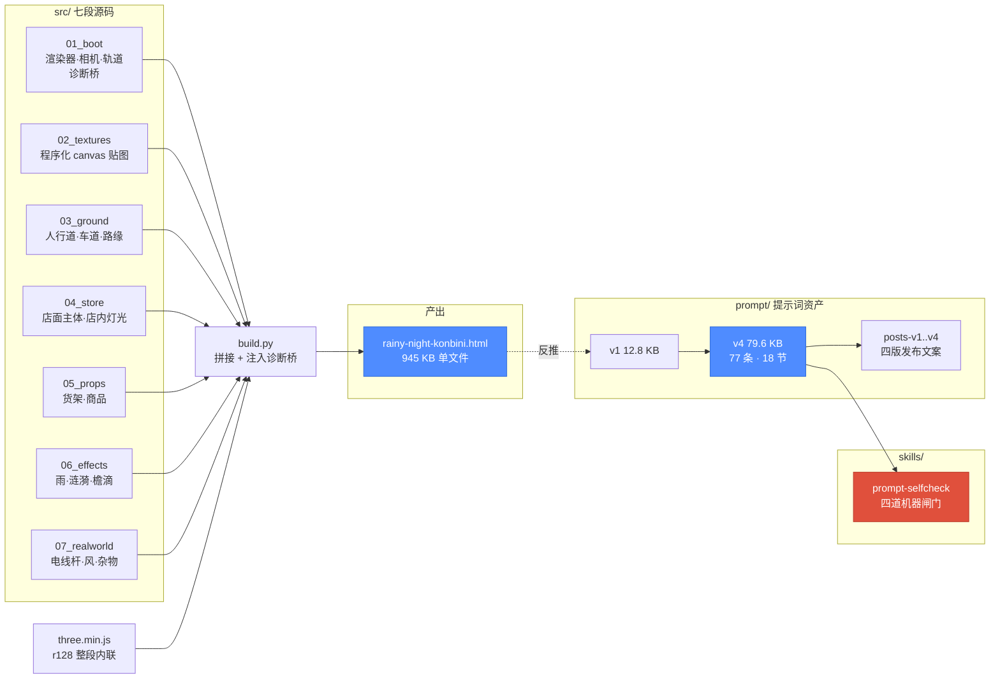

# 雨夜便利店街角 · 微缩 3D 街景

> **一个 945 KB 的单文件 HTML：断网可开、零 UI、三渲二硬边，一座可以自由旋转缩放的雨夜便利店街角微缩模型。**
>
> 附带这份场景**反推出来的 77 条分级提示词**（v1→v4 全文，含修订痕迹），以及从过程中沉淀出的 [`prompt-selfcheck`](skills/prompt-selfcheck/) skill。

| | |
|---|---|
| **类型** | 3D 场景 / 生成式提示词资产 |
| **状态** | 已完成，经 20 轮外部评审（r5–r20） |
| **入口** | [`dist/rainy-night-konbini.html`](dist/rainy-night-konbini.html) —— 下载后双击即开 |
| **在线** | <https://78tyih.github.io/rainy-night-konbini/showcase.html> |
| **展示页** | [`docs/showcase.html`](docs/showcase.html)（ZH/EN × 日/夜） |
| **授权** | **仓库无 LICENSE 文件。方法论可参考，代码复制需授权。** |

---

## 1 · 解决什么问题

难的不是「搭一个 3D 场景」，而是两件都没有现成答案的事：

**① 让一座微缩模型看着像微缩模型，而不是实景。**
同一个模型，广角一拍就是实景，视角一收才是缩微。差别不在模型，在**相机、色阶、和"什么东西最亮"**。

**② 把只能靠眼睛调的参数，写成别人能照抄的提示词。**
「灯要亮一点」「货架要密一点」这种判断无法移交。本项目把它拆成 77 条，每条标了是**设计判断**（Invariant）还是**项目取值**（Recipe / Implementation）——读者知道哪些必须照抄、哪些该重新推导。

**边界**：本项目不解决建模、不解决 PBR 真实感、不做交互 UI。它是一条「用提示词固化美学方向」的路径。

---

## 2 · 什么场景 → 什么结果

| 场景 | 之前 | 之后 |
|---|---|---|
| 零成本验证一条街景的美学方向 | 开建模软件、找贴图、等编译，改一盏灯要十分钟 | 改提示词一行，刷新浏览器，两秒看到结果 |
| 把「只能意会」的微缩感固化成可移交规格 | 调完即忘，下次从头试错 | 77 条分级条款 + 源码出处表，别人能照抄 |
| 离线演示 / 嵌入任意页面 | 需要构建工具、CDN、贴图文件 | 单个 `.html`，不请求任何外部资源 |

**最小使用路径**：下载 `dist/rainy-night-konbini.html` → 双击打开 → 左键拖拽旋转、滚轮缩放、右键平移。

---

## 3 · 什么结构



### 模块表

| 位置 | 职责 | 边界 |
|---|---|---|
| `src/01_boot.js` | 渲染器 / 相机 / 轨道控制 / 诊断桥 | 不建场景内容 |
| `src/02_textures.js` | 程序化 canvas 贴图（货架排面、地面、品牌色带） | 不读外部图片 |
| `src/03_ground.js` | 人行道 / 车道 / 路缘 / 土壤 | 不含建筑 |
| `src/04_store.js` | 店面主体：立面、腰壁、雨棚、招牌、店内灯光 | 最大的一段 |
| `src/05_props.js` | 货架、商品、室内道具 | 不含建筑与天气 |
| `src/06_effects.js` | 雨、涟漪、檐滴、水洼 | 不含静物 |
| `src/07_realworld.js` | 街外世界：电线杆、围墙、杂物、风 | 不含店面内部 |
| `src/build.py` | 拼接 `three.min.js` + 七段 → 单文件，注入诊断桥 | 唯一构建入口 |
| `src/_rig.py` | 探针夹具：取得 `scene` / `camera` / `renderer` | 仅测试用 |
| `prompt/` | v1–v4 提示词全文 + 四版发布文案 | v1–v3 保留当时错误，未回溯 |
| `skills/prompt-selfcheck/` | 沉淀出的提示词自检 skill | 零第三方依赖 |

---

## 4 · 能复用什么

| 可复用的东西 | 在哪 | 依赖 | 授权 |
|---|---|---|---|
| 单文件 three.js 场景骨架（boot + 诊断桥） | `src/01_boot.js` | three.js（r160 前的 UMD 构建） | 无 LICENSE，需授权 |
| 三渲二硬边色阶（N=4 NearestFilter ramp） | `src/02_textures.js` | 无 | 同上 |
| 程序化货架排面生成（512×256、4 行、排面 28–46 px） | `src/02_textures.js` | 无 | 同上 |
| AR(1) 风 + 涟漪扩张模型 | `src/06_effects.js` | 无 | 同上 |
| **prompt-selfcheck**（四道闸门，零依赖） | `skills/prompt-selfcheck/` | Python 3 标准库 | 同上 |

### 直接可用：prompt-selfcheck

从这份场景的提示词迭代里长出来的自检工具，一条命令跑 19 项反证：

```bash
python3 skills/prompt-selfcheck/scripts/check_prompt.py selftest
```

它查的是**任何版本化提示词文档**都会犯、而人手查不出的三类失败：

1. **编号断裂** —— 条款跳号/重复，"第 35 条"引用指向不存在的东西
2. **副本不同步** —— 文档与推文里各有一份，改一处忘另一处
3. **旧错复活** —— 修掉的错又在摘要表/推文里冒出来

它**不证明文档正确**，只证明上面三件事加"闸门自己没坏"。

---

## 修订痕迹：我们错在哪

这份仓库故意保留错误，因为错误比结论更可迁移。

**① 「玻璃带占立面总高 65%」——这个数是我们编的。**
用我们自己给的标高，任何分母都推不出 65%（最接近 70.6% 和 80.4%；凑 65% 需要 2.846 m 分母，立面里没这一段）。
**真相**：源码注释写的是「窗下墙体不要超过 **0.65 m**」——**单位是米，不是百分比**。转录时长度变成了比例。

**② 「店内灯被货架端头挡住」——机制是错的。**
全工程 `castShadow` 只有一处（月光），点光源不可能被货架挡住。
**真相**：灯装在 y 0.6–1.2 m，低于货架顶 1.49 m，**被埋进货架体内**；修法是抬到 y = 2.20。

> 这两条当时**看上去都是自洽的**：65% 能被反向验算，遮挡因果符合直觉。所以人手 review 抓不到——
> 只有把每条声明拿去和源码、和算术对质，才会露。这也是 `prompt-selfcheck` 存在的原因。

完整修订记录见 [`showcase/evidence.md`](showcase/evidence.md) 与 [`prompt/konbini-3d-prompt-v4.md`](prompt/konbini-3d-prompt-v4.md)。

---

## 已知缺口（不假装）

- 仓库未内置自动化浏览器测试；渲染声明来自源码检索与人工查看。
- 提示词要求「按参考图校准」，但本仓库未附参考图。
- `prompt-selfcheck` 只在本文档形态上验证过，**尚未在第二个不相关项目上跑通**——这是它固化的前置测试，未做。
- 英文版发布文案待定。
- 性能数据（帧率 / 加载耗时）未测，不编造。

---

## 目录

```
rainy-night-konbini/
├── dist/rainy-night-konbini.html   # 945 KB 单文件产物（唯一下载即用的东西）
├── src/                            # 七段源码 + build.py + 探针夹具
├── prompt/                         # v1–v4 提示词 + 四版发布文案
├── skills/prompt-selfcheck/        # 沉淀出的 skill（四道闸门）
├── docs/showcase.html              # 展示页（ZH/EN × 日/夜）
└── showcase/                       # project.json 事实包 + evidence.md 证据分级
```
